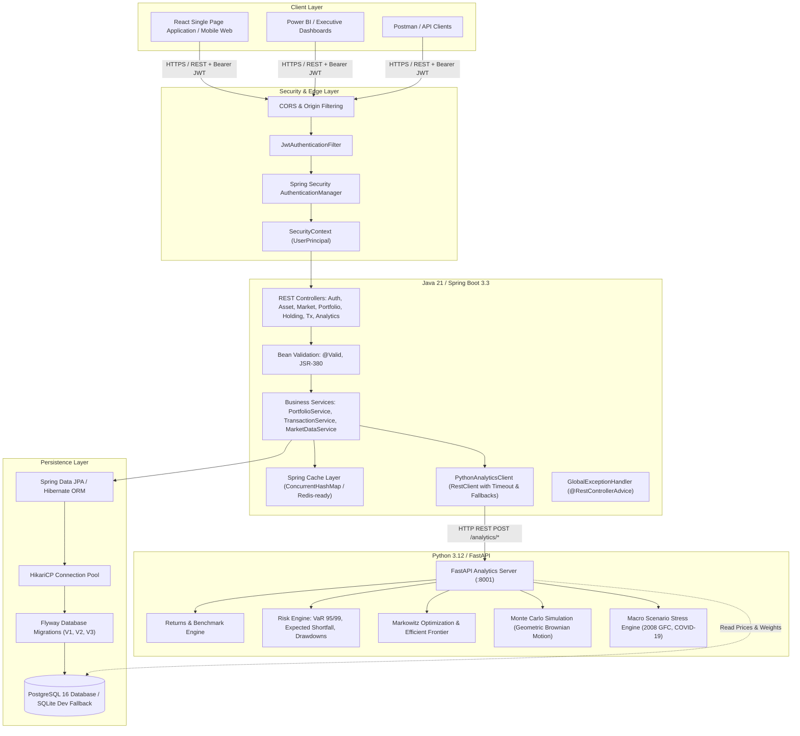

# Architecture Design: Enterprise Multi-Asset Portfolio Risk & Analytics System

## 1. System Overview

The **Enterprise Multi-Asset Portfolio Risk & Performance Analytics Platform** is a distributed, high-performance financial engineering system built across two specialized tiers:
1. **Part 1 — Quantitative Financial Engine (Python / FastAPI / NumPy / Pandas)**:
   Responsible for heavy quantitative modeling, risk measurement, Cholesky-correlated Monte Carlo simulations, Markowitz mean-variance optimization, Euler component risk attribution, and macroeconomic stress testing.
2. **Part 2 — Enterprise Backend & REST API Layer (Java 21 / Spring Boot 3.3 / Spring Security / JPA / PostgreSQL)**:
   Responsible for user identity, JWT authentication, role-based access control, strict multi-tenant isolation, portfolio/holding/transaction lifecycle management, mark-to-market valuation, business validation (long-only execution), caching, and orchestrating upstream analytics calls via modern `RestClient`.

---

## 2. Distributed Architecture Diagram

---

## 3. Separation of Responsibilities

### Java / Spring Boot Layer
- **Identity & Authorization**: BCrypt password hashing, signed JJWT tokens (access + refresh), user tenant isolation.
- **Data Integrity & Long-Only Validation**: Transaction recording enforces available share balance; prevents accidental naked short sales.
- **Valuation**: Fast in-memory mark-to-market calculations combining current holdings with latest market prices.
- **Caching**: Performance and risk computation payloads cached with automatic invalidation upon new trades or price updates.
- **API Standards**: Uniform JSON envelopes (`ApiResponse<T>`, `ApiErrorResponse`), standard HTTP status codes (200, 201, 400, 401, 403, 404, 409, 503).
- **Resilience**: Actuator custom health indicator monitors FastAPI connectivity. If the analytics engine is offline, requests return clean `503 Service Unavailable` with `ANALYTICS_SERVICE_UNAVAILABLE`.

### Python / FastAPI Quantitative Engine
- **Returns Analytics**: Arithmetic, logarithmic, cumulative, annualized CAGR, rolling excess returns, tracking error, information ratio.
- **Risk Analytics**: Volatility, downside semi-deviation, Sharpe ratio, Sortino ratio, CAPM Alpha and Beta.
- **Value at Risk (VaR)**: Historical percentile VaR (95% & 99%), Parametric Gaussian VaR, Conditional VaR (Expected Shortfall / CVaR), and Dollar VaR.
- **Diversification & Attribution**: Full covariance/correlation matrices, Euler risk decomposition (marginal and component percentage risk contributions).
- **Optimization**: Modern Portfolio Theory (MPT) mean-variance optimization (Max Sharpe, Min Variance, Equal Weight) and Efficient Frontier stochastic sampling.
- **Stochastic Simulation**: Correlated geometric Brownian motion paths over customizable horizons (e.g., 252 trading days, 5,000 paths).
- **Macro Stress Testing**: Instant historical scenario replay (2008 Financial Crisis, 2020 COVID-19 shock, Tech Stagflation).

---

## 4. Multi-Tenant Security & Isolation Model

Every portfolio is strictly linked via foreign key to a `User` entity (`user_id`).
- When any portfolio-scoped endpoint is called (`/api/portfolios/{id}/**`), the `PortfolioService.checkOwnership()` method verifies that the authenticated `UserPrincipal` matches the owner of the portfolio or holds `ROLE_ADMIN`.
- If an unauthenticated user attempts access: **401 Unauthorized** is returned.
- If an authenticated user attempts to access another user's portfolio: **403 Forbidden** is returned.
- Passwords are never serialized into DTOs or log outputs.
