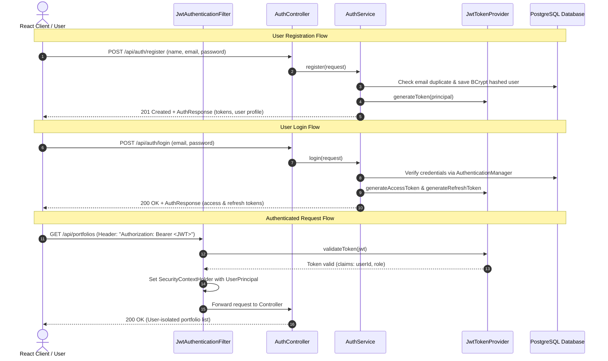

# Authentication & Security Architecture

## 1. Overview

The Portfolio Analytics platform implements a stateless **JSON Web Token (JWT)** authentication model using **Spring Security 6** and **Java JWT (jjwt 0.12.6)**. All sensitive credentials are encrypted using **BCrypt** with an adaptive work factor.

Passwords are never logged or returned in any JSON response.

---

## 2. Authentication Flow



---

## 3. Token Specifications

### Access Token
- **Format**: Signed HMAC-SHA256 (HS256) JWT.
- **Default TTL**: 24 hours (`86400000` ms, configurable via `jwt.expiration-ms`).
- **Claims**:
  - `sub`: User ID (Numeric string, e.g. `"1"`)
  - `email`: User email address
  - `name`: User full name
  - `iat`: Issue timestamp
  - `exp`: Expiry timestamp

### Refresh Token
- **Format**: Cryptographically signed refresh token.
- **Default TTL**: 7 days (`604800000` ms, configurable via `jwt.refresh-expiration-ms`).
- **Usage**: Sent to `POST /api/auth/refresh` to obtain a fresh access token without re-entering credentials.

---

## 4. Endpoints & Request/Response Payloads

### 1. Register Account
`POST /api/auth/register`

**Request:**
```json
{
  "name": "Harsh",
  "email": "harsh@example.com",
  "password": "SecurePassword123"
}
```

**Response (201 Created):**
```json
{
  "success": true,
  "data": {
    "accessToken": "eyJhbGciOiJIUzI1NiIsInR5cCI6IkpXVCJ9...",
    "refreshToken": "eyJhbGciOiJIUzI1NiIsInR5cCI6IkpXVCJ9...",
    "tokenType": "Bearer",
    "expiresInMs": 86400000,
    "user": {
      "id": 1,
      "name": "Harsh",
      "email": "harsh@example.com",
      "role": "USER",
      "active": true,
      "createdAt": "2026-10-07T12:00:00Z"
    }
  },
  "message": "User registered successfully.",
  "timestamp": "2026-10-07T12:00:00Z"
}
```

### 2. Login
`POST /api/auth/login`

**Request:**
```json
{
  "email": "harsh@example.com",
  "password": "SecurePassword123"
}
```

**Response (200 OK):**
```json
{
  "success": true,
  "data": {
    "accessToken": "eyJhbGciOiJIUzI1NiIsInR5cCI6IkpXVCJ9...",
    "refreshToken": "eyJhbGciOiJIUzI1NiIsInR5cCI6IkpXVCJ9...",
    "tokenType": "Bearer",
    "expiresInMs": 86400000,
    "user": {
      "id": 1,
      "name": "Harsh",
      "email": "harsh@example.com",
      "role": "USER",
      "active": true
    }
  },
  "message": "Authenticated successfully.",
  "timestamp": "2026-10-07T12:00:00Z"
}
```

### 3. Refresh Token
`POST /api/auth/refresh`

**Request:**
```json
{
  "refreshToken": "eyJhbGciOiJIUzI1NiIsInR5cCI6IkpXVCJ9..."
}
```

### 4. Current User Profile
`GET /api/auth/me`  
**Header**: `Authorization: Bearer <accessToken>`

**Response (200 OK):**
```json
{
  "success": true,
  "data": {
    "id": 1,
    "name": "Harsh",
    "email": "harsh@example.com",
    "role": "USER",
    "active": true
  },
  "timestamp": "2026-10-07T12:00:00Z"
}
```
