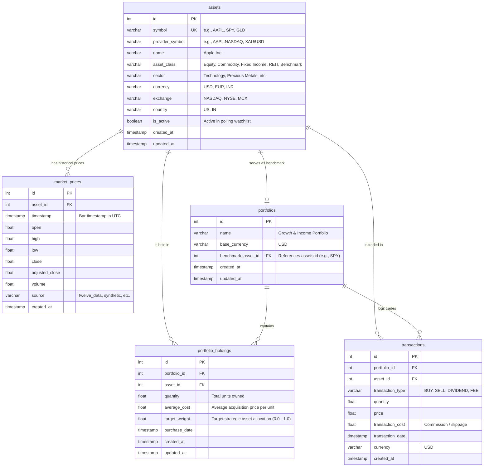

# Database Schema & Entity Relationships

The Data & Analytics Engine relies on a normalized relational database schema designed for financial market data and investment portfolio management. It is implemented using SQLAlchemy 2.x ORM models and supports both PostgreSQL (production) and SQLite (development/local testing).

---

## 1. Entity-Relationship Diagram (ERD)

---

## 2. Table Specifications

### 2.1. `assets`
Stores financial instruments across all supported asset classes (Equities, ETFs, Bonds, Commodities, REITs).

| Column | Type | Constraints | Description |
| :--- | :--- | :--- | :--- |
| `id` | `INTEGER` | `PRIMARY KEY`, `AUTOINCREMENT` | Unique internal asset identifier |
| `symbol` | `VARCHAR(32)` | `UNIQUE`, `NOT NULL`, `INDEX` | Standard ticker symbol (e.g. `AAPL`) |
| `provider_symbol` | `VARCHAR(64)` | `NOT NULL`, `INDEX` | Provider-specific symbol (e.g. `AAPL:NASDAQ`) |
| `name` | `VARCHAR(255)` | `NOT NULL` | Full instrument name |
| `asset_class` | `VARCHAR(64)` | `NOT NULL`, `INDEX` | `Equity`, `Commodity`, `Fixed Income`, `REIT`, `Index` |
| `sector` | `VARCHAR(128)` | `NULLABLE` | Sector classification (e.g. `Technology`, `Energy`) |
| `currency` | `VARCHAR(8)` | `NOT NULL`, Default: `'USD'` | Denomination currency |
| `exchange` | `VARCHAR(64)` | `NULLABLE` | Primary exchange (e.g. `NASDAQ`, `NYSE`) |
| `country` | `VARCHAR(64)` | `NULLABLE` | Country of domicile (e.g. `US`, `IN`) |
| `is_active` | `BOOLEAN` | `NOT NULL`, Default: `TRUE` | Whether asset is included in active ingestion |
| `created_at` | `TIMESTAMP WITH TIME ZONE` | Default: `UTC NOW` | Audit timestamp |
| `updated_at` | `TIMESTAMP WITH TIME ZONE` | Default: `UTC NOW` | Last update timestamp |

---

### 2.2. `market_prices`
Stores historical and intraday OHLCV time-series price bars.

| Column | Type | Constraints | Description |
| :--- | :--- | :--- | :--- |
| `id` | `INTEGER` | `PRIMARY KEY`, `AUTOINCREMENT` | Unique price bar ID |
| `asset_id` | `INTEGER` | `FOREIGN KEY(assets.id)`, `CASCADE` | Foreign key referencing asset |
| `timestamp` | `TIMESTAMP WITH TIME ZONE` | `NOT NULL`, `INDEX` | Bar close/observation time (UTC) |
| `open` | `FLOAT` | `NOT NULL` | Open price |
| `high` | `FLOAT` | `NOT NULL` | High price |
| `low` | `FLOAT` | `NOT NULL` | Low price |
| `close` | `FLOAT` | `NOT NULL` | Close price |
| `adjusted_close` | `FLOAT` | `NULLABLE` | Dividend/split-adjusted close |
| `volume` | `FLOAT` | `NOT NULL`, Default: `0.0` | Trading volume |
| `source` | `VARCHAR(64)` | `NOT NULL`, Default: `'twelve_data'` | Vendor source tag |
| `created_at` | `TIMESTAMP WITH TIME ZONE` | Default: `UTC NOW` | Ingestion timestamp |

#### Constraints & Indexes
- **Unique Constraint (`uq_asset_time_source`)**: `UNIQUE(asset_id, timestamp, source)` prevents duplicate bars.
- **Compound Index (`ix_market_prices_asset_timestamp`)**: Index on `(asset_id, timestamp)` for high-performance range queries and time-series pivot matrix extractions.

---

### 2.3. `portfolios`
Portfolio definitions and benchmark assignments.

| Column | Type | Constraints | Description |
| :--- | :--- | :--- | :--- |
| `id` | `INTEGER` | `PRIMARY KEY`, `AUTOINCREMENT` | Unique portfolio ID |
| `name` | `VARCHAR(255)` | `NOT NULL`, `INDEX` | Portfolio portfolio name |
| `base_currency` | `VARCHAR(8)` | `NOT NULL`, Default: `'USD'` | Portfolio base currency |
| `benchmark_asset_id` | `INTEGER` | `FOREIGN KEY(assets.id)`, `SET NULL` | Benchmark asset (e.g. SPY, QQQ) |
| `created_at` | `TIMESTAMP WITH TIME ZONE` | Default: `UTC NOW` | Creation timestamp |
| `updated_at` | `TIMESTAMP WITH TIME ZONE` | Default: `UTC NOW` | Last modified timestamp |

---

### 2.4. `portfolio_holdings`
Represents the current held quantity and cost basis of an asset in a portfolio.

| Column | Type | Constraints | Description |
| :--- | :--- | :--- | :--- |
| `id` | `INTEGER` | `PRIMARY KEY`, `AUTOINCREMENT` | Primary key |
| `portfolio_id` | `INTEGER` | `FOREIGN KEY(portfolios.id)`, `CASCADE` | Portfolio reference |
| `asset_id` | `INTEGER` | `FOREIGN KEY(assets.id)`, `RESTRICT` | Asset reference |
| `quantity` | `FLOAT` | `NOT NULL` | Number of shares / units held |
| `average_cost` | `FLOAT` | `NOT NULL` | Weighted average acquisition price per unit |
| `target_weight` | `FLOAT` | `NULLABLE` | Model portfolio strategic target allocation |
| `purchase_date` | `TIMESTAMP WITH TIME ZONE` | Default: `UTC NOW` | Initial purchase date |
| `created_at` | `TIMESTAMP WITH TIME ZONE` | Default: `UTC NOW` | Audit creation date |
| `updated_at` | `TIMESTAMP WITH TIME ZONE` | Default: `UTC NOW` | Position update date |

#### Constraints
- **Unique Constraint (`uq_portfolio_asset`)**: `UNIQUE(portfolio_id, asset_id)` guarantees one row per asset per portfolio.

---

### 2.5. `transactions`
Immutable ledger of trades and cashflow operations.

| Column | Type | Constraints | Description |
| :--- | :--- | :--- | :--- |
| `id` | `INTEGER` | `PRIMARY KEY`, `AUTOINCREMENT` | Transaction ID |
| `portfolio_id` | `INTEGER` | `FOREIGN KEY(portfolios.id)`, `CASCADE` | Portfolio reference |
| `asset_id` | `INTEGER` | `FOREIGN KEY(assets.id)`, `RESTRICT` | Asset reference |
| `transaction_type` | `VARCHAR(16)` | `NOT NULL` | `BUY`, `SELL`, `DIVIDEND`, `FEE` |
| `quantity` | `FLOAT` | `NOT NULL` | Units transacted |
| `price` | `FLOAT` | `NOT NULL` | Execution price |
| `transaction_cost` | `FLOAT` | `NOT NULL`, Default: `0.0` | Broker commission and exchange fees |
| `transaction_date` | `TIMESTAMP WITH TIME ZONE` | `NOT NULL`, `INDEX` | Execution timestamp |
| `currency` | `VARCHAR(8)` | `NOT NULL`, Default: `'USD'` | Currency of transaction |
| `created_at` | `TIMESTAMP WITH TIME ZONE` | Default: `UTC NOW` | Ledger insertion timestamp |

---

## 3. Database Engine Support & Migrations

1. **PostgreSQL**: Production deployment via psycopg binary driver. Full relational constraints, foreign key cascades, and high-concurrency connection pooling via SQLAlchemy QueuePool.
2. **SQLite**: Automatic local development fallback when PostgreSQL is unreachable or when running standalone CLI tools and integration test suites without external service dependencies.
3. **Alembic Migrations**: All migrations are managed in `migrations/` (`001_initial_schema.py`). New schema changes are versioned and executable via `alembic upgrade head`.
